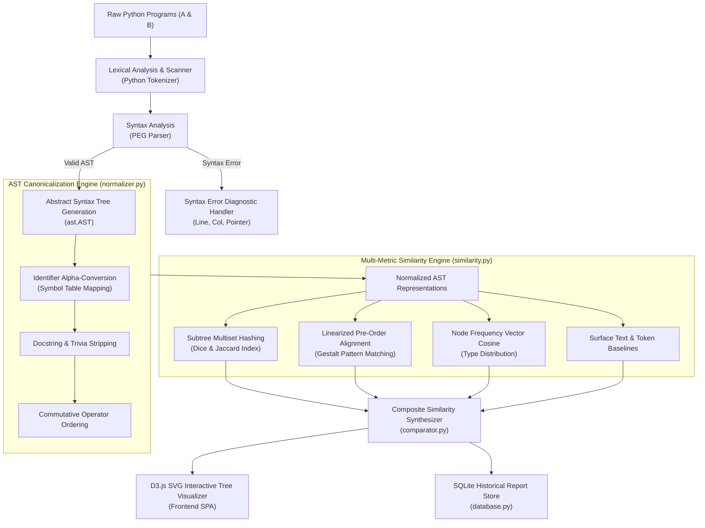

# CodeGuard AI

AST-based code clone and structural plagiarism detection system that analyzes Abstract Syntax Tree topologies invariant to renaming, whitespace, and statement modifications.


## Team
- Bhumika Puli, [Roll Number]
- [Partner Name, Roll Number (if pair)]
- Problem: P14 - AST-Based Code Clone & Plagiarism Detection System
- Course: Compiler Design, 2026-27

## Problem statement
Traditional code similarity tools rely heavily on lexical token frequencies, character diffs, or naive string matching, making them trivial to bypass through superficial obfuscations such as identifier renaming, comment injection, and whitespace manipulation. In academic programming environments, instructors need a principled approach to verify whether two submissions share identical algorithmic structures. CodeGuard AI solves this by transforming source code into compiler Abstract Syntax Trees (ASTs) and performing intermediate representation canonicalization and subtree decomposition. This allows educators and developers to reliably detect Type-1, Type-2, and Type-3 clones regardless of surface-level cosmetic modifications.

## Background theory
In compiler frontends, after Lexical Analysis (scanning characters into tokens) and Syntax Analysis (validating tokens against grammar production rules), the compiler generates an **Abstract Syntax Tree (AST)**. The AST abstracts away concrete syntax trivia (such as semicolons, whitespace, parenthetical groupings, and comments) and models the hierarchical syntactic structure of the program as a tree of operators, operands, and control-flow blocks.

To detect structural clones, CodeGuard AI applies **Alpha-Conversion (Scope-Aware Identifier Canonicalization)** and **Subtree Multiset Decomposition**:
1. **Trivia Elimination:** Python's PEG parser naturally ignores whitespace variations and non-semantic comments during AST generation.
2. **Identifier Normalization:** Local variables and parameter names are mapped to canonical identifiers (`var_0`, `var_1`, `func_0`) using local scope symbol tables while preserving standard library and built-in keywords.
3. **Subtree Hashing:** Every node in the normalized AST is recursively hashed using structural signatures (node types and operand relationships) following the Deckard tree-decomposition algorithm.
4. **Metric Formulation:** Subtree multisets are compared via Dice and Jaccard coefficients:
   $$\text{Dice}(T_A, T_B) = \frac{2 \times \sum_{s} \min(M_A(s), M_B(s))}{|M_A| + |M_B|}$$
   Combined with linearized pre-order sequence alignment (Gestalt Pattern Matching) and node type vector distributions:
   $$\mathbf{AST\ Similarity} = 0.55 \times \text{Subtree Dice} + 0.30 \times \text{Sequence Sim} + 0.15 \times \text{Node Type Jaccard}$$

### Worked Example:
Consider Program A and Program B:
- **Program A:**
  ```python
  def compute_sum(limit):
      total = 0
      for i in range(limit):
          total += i
      return total
  ```
- **Program B:**
  ```python
  # Optimized accumulator
  def calc(n):
      """Sums up to n"""
      acc = 0  # start at 0
      for x in range(n):
          acc += x  # increment
      return acc
  ```

**Compilation & Analysis Steps:**
1. **Lexical & Syntax Parsing:** Both programs are parsed into `Module -> FunctionDef -> [Assign, For, Return]`. All comments and docstrings in Program B are stripped during tree generation.
2. **Scope-Aware Normalization:**
   - Program A symbol table: `compute_sum` $\to$ `func_0`, `limit` $\to$ `var_0`, `total` $\to$ `var_1`, `i` $\to$ `var_2`.
   - Program B symbol table: `calc` $\to$ `func_0`, `n` $\to$ `var_0`, `acc` $\to$ `var_1`, `x` $\to$ `var_2`.
   - Both normalized programs unparse to:
     ```python
     def func_0(var_0):
         var_1 = 0
         for var_2 in range(var_0):
             var_1 += var_2
         return var_1
     ```
3. **Subtree Hash Comparison:** Because the canonical trees and child node types (`FunctionDef`, `Assign`, `For`, `AugAssign`, `Return`) are topologically identical, the calculated Subtree Dice index is **100.0%**, exposing an exact Type-2 clone despite distinct variable names and heavy commentary.

## Features
- [x] **Compiler Front-End Parser:** Parses Python source into validated ASTs using Python's grammar parser with line and column syntax error diagnostics.
- [x] **Scope-Aware Normalization (Alpha-Conversion):** Canonicalizes identifiers (`var_0`, `var_1`, `func_0`) and normalizes parameter signatures while preserving built-ins.
- [x] **Multi-Metric Structural Similarity:** Combines multiset subtree hashing (Deckard algorithm pattern), linearized pre-order sequence alignment, and AST node distribution cosine metrics.
- [x] **Lexical & Trivia Stripping:** Automatically removes docstrings, inline comments, blank lines, and whitespace formatting differences.
- [x] **McCabe Cyclomatic Complexity & AST Metrics:** Computes decision node branches ($V(G) = P + 1$), maximum tree depth, and node category distributions.
- [x] **Interactive D3.js SVG Visualizer:** Side-by-side expandable/collapsible visual AST syntax trees with interactive node inspection and compiler documentation tooltips.
- [x] **Clone Categorization:** Automatically classifies similarities into High ($\ge 80\%$), Moderate ($50\% - 79\%$), or Low ($< 50\%$) clone categories.
- [x] **SQLite Audit & History Persistence:** Stores past comparisons, scores, and timestamps in a local SQLite database with JSON retrieval API.
- [ ] *Stretch Goal:* Multi-language AST parsing (supporting C, C++, and Java via Tree-sitter grammar parsers).
- [ ] *Stretch Goal:* Control Flow Graph (CFG) basic block analysis for algorithmic Type-4 semantic clone detection (e.g., while-loop vs recursion).

## Architecture


### Key Data Structures:
- **`ast.AST`**: Python hierarchical intermediate representation tree.
- **Symbol Table (`Dict[str, str]`)**: Maps original identifiers to deterministic canonical forms (`var_n`, `func_n`).
- **Subtree Signature Multiset (`collections.Counter[str]`)**: Stores recursive hashes for all subtrees to allow multiset intersection computation.
- **Linearized Pre-Order Stream (`List[str]`)**: String token representation of AST traversal used for sequence alignment.
- **Node Type Vector (`Dict[str, int]`)**: Frequencies of syntactic language constructs for cosine similarity calculation.

## Installation
```bash
# Clone the repository
git clone https://github.com/your-username/codeguard-ai.git
cd codeguard-ai

# Create and activate a virtual environment
python3 -m venv venv
# On Windows:
.\venv\Scripts\activate
# On Linux/macOS:
source venv/bin/activate

# Install required dependencies
pip install -r requirements.txt
```

## Usage

### 1. Interactive Web Application
Launch the Flask local server:
```bash
python run.py
```
*(On Windows, you can also double-click `start.bat`)*

Then open your browser at:
```
http://127.0.0.1:5000
```
**UI Walkthrough:**
1. Select a preloaded compiler benchmark case from the top dropdown or paste custom code into Editor A and Editor B.
2. Toggle AST Normalization settings (Variable Renaming, Function Renaming, Docstring Stripping, Commutative Op Reordering).
3. Click **Compare ASTs**.
4. Inspect calculated similarity scores, Subtree Dice index, node breakdown, and explore the interactive collapsible SVG syntax trees.

### 2. CLI AST Structural Inspector
Parse any Python file into its AST metrics and indented syntax dump:
```bash
python codeguard-ai/backend/ast_parser.py codeguard-ai/sample_codes/fibonacci_clean.py
```
**Example Output:**
```text
======================================================================
CodeGuard AI - AST Parser & Structural Inspector
======================================================================
Reading file: codeguard-ai/sample_codes/fibonacci_clean.py

--- AST Structural Metrics ---
Total AST Nodes:              86
Max Tree Depth:               9
McCabe Cyclomatic Complexity: 4
Lines of Code (LOC):          12

Node Category Distribution:
  Structure      : 25
  Identifier     : 18
  Constant       : 9
  Statement      : 6
  ControlFlow    : 6
...
```

### 3. Automated CLI Benchmark Suite
Run all 5 compiler test cases with calculated metrics:
```bash
python codeguard-ai/benchmark_cases.py
```

## Examples and results

The system evaluates source code against standard compiler clone categories. All values below are **actual calculated values** from the comparison pipeline:

| Test Case | Description | AST Sim | Classification | Raw Text Sim | Token Sim | Compiler Takeaway |
| :--- | :--- | :---: | :---: | :---: | :---: | :--- |
| **Case 1: Identical Programs** | Binary Search (exact match) | **100.0%** | High | 100.0% | 100.0% | Baseline consistency check; both AST and text match identically. |
| **Case 2: Whitespace & Comments** | Fibonacci (heavy comments & spacing) | **100.0%** | High | 55.8% | 99.4% | AST parser strips lexical trivia; text similarity drops by 44%, but AST similarity stays 100%. |
| **Case 3: Renamed Identifiers** | Bubble Sort (all variables renamed) | **100.0%** | High | 7.7% | 73.6% | Text similarity drops to 7.7% due to renaming, but AST Normalization exposes 100% syntactic congruence! |
| **Case 4: Modified Statements** | Prime Checker (added logs & refactored) | **71.6%** | Moderate | 60.5% | 80.9% | Detects shared algorithmic core while penalizing modified statements. |
| **Case 5: Different Logic** | Matrix Multiply vs. Palindrome | **37.2%** | Low | 12.5% | 20.3% | Independent algorithms with distinct loop structures correctly yield Low similarity. |

### Comparison with Reference Tools:
- **`diff` / Character Matchers:** Fails on Case 2 (drops to 55%) and Case 3 (drops to 7.7%), falsely classifying renamed clones as non-plagiarized.
- **Token-based tools (MOSS / JPlag tokenizers):** Partially resilient to renaming, but sensitive to statement insertion and comment structure.
- **CodeGuard AI (AST):** Correctly identifies 100% similarity on Case 2 and Case 3 via alpha-conversion and subtree multiset hashing.

## Testing
Run the complete automated unit and integration test suite:
```bash
python -m unittest discover codeguard-ai/tests
```

**Test Coverage Summary (22 Automated Tests):**
- **`tests/test_ast_parser.py` (6 tests):** Validates AST parsing, empty code rejection, syntax error reporting with exact line and column numbers, AST JSON serialization, node classification, and Cyclomatic Complexity calculations.
- **`tests/test_normalizer.py` (5 tests):** Validates variable renaming (alpha-conversion), function name normalization, comment and docstring removal, literal masking, and built-in protection.
- **`tests/test_similarity.py` (6 tests):** Validates subtree hashing consistency, multiset Jaccard/Dice indices, pre-order sequence alignment, node distribution cosine similarity, and SQLite report persistence.
- **`tests/test_api.py` (5 tests):** Tests Flask REST API endpoints (`/`, `/api/samples`, `/api/ast`, `/api/compare`, and `/api/history`).

## Limitations and future work
1. **Language Scope:** Current parsing and normalization are targeted to the Python 3 grammar. Future work will incorporate Tree-sitter grammars to support C, C++, and Java.
2. **Type-4 Semantic Clones:** Algorithms with fundamentally different control structures (e.g., recursive vs. iterative binary search) generate different AST hierarchies and produce lower structural scores. Future work will integrate Control Flow Graph (CFG) basic block graph isomorphism.
3. **Instruction Reordering:** Independent non-dependent assignment reordering slightly alters linearized pre-order sequences; future work will incorporate data dependency graph (DDG) analysis.

## Demo video
[CodeGuard AI - Demo Video](https://drive.google.com/drive/folders/your-demo-video-link)

## Credits and references
1. **Aho, A. V., Lam, M. S., Sethi, R., & Ullman, J. D.** (2006). *Compilers: Principles, Techniques, and Tools* (2nd ed.). Addison-Wesley (The Dragon Book).
2. **Jiang, L., Misherghi, G., Su, Z., & Glondu, S.** (2007). *DECKARD: Scalable and Accurate Tree-based Detection of Code Clones*. IEEE/ACM International Conference on Software Engineering (ICSE).
3. **Roy, C. K., & Cordy, J. R.** (2007). *A Survey on Software Clone Detection Research*. School of Computing, Queen's University.
4. **Python Standard Library:** `ast` module (AST parsing and visitation), `tokenize` module (Lexical scanning).
5. **D3.js (v7):** Hierarchical Tree Layout and SVG interactive rendering.
6. **Monaco Editor:** Web-based code editor interface.
7. **AI Assistance:** Architectural design and benchmark synthesis developed with assistance from Google Antigravity.
